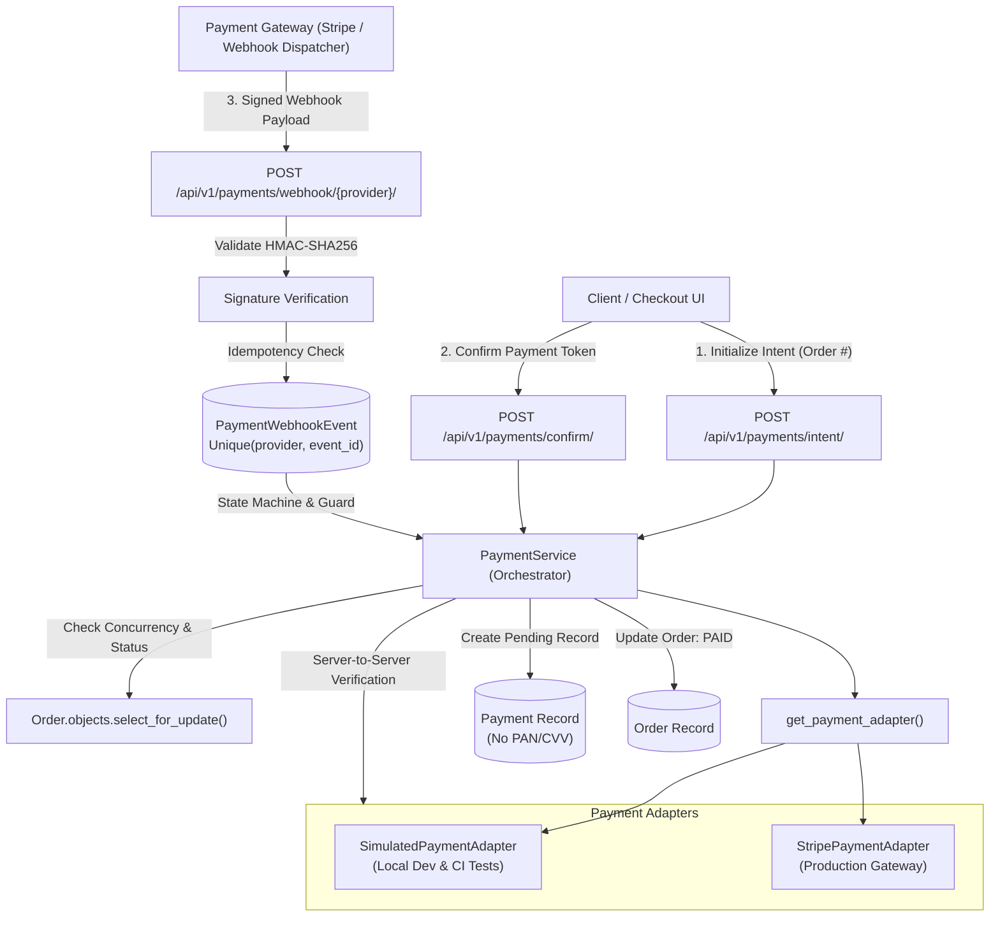
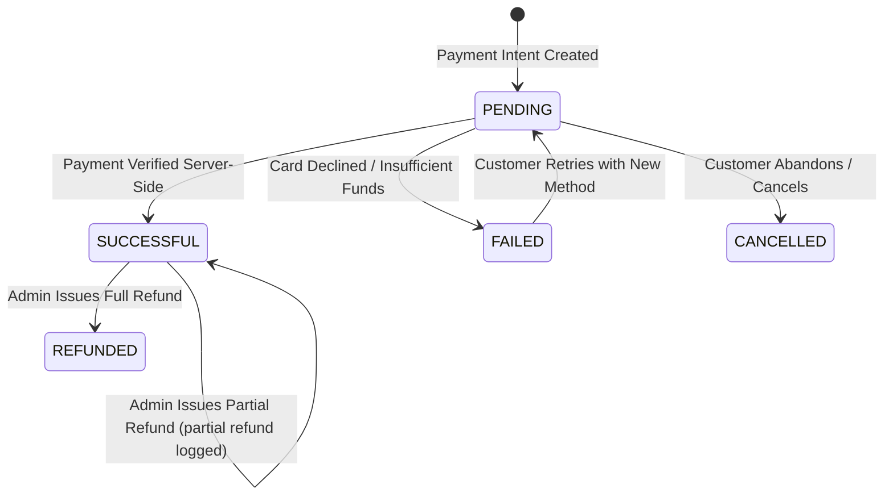

# Payment Integration Architecture

A resilient, PCI-DSS compliant payment integration architecture for the full-stack enterprise e-commerce platform.

---

## 1. Architectural Overview

---

## 2. Payment Lifecycle & State Machine

### Order Status Synchronization Rules:
1. **PENDING Payment**: Order remains `PENDING`.
2. **SUCCESSFUL Payment**: Payment status becomes `COMPLETED`/`SUCCESSFUL`, Order status transitions to `PAID`.
3. **FAILED Payment**: Payment status marked `FAILED`. Order remains `PENDING` to allow customer retry without duplicate order creation.
4. **Out-of-Order / Delayed Webhooks**: If a late `FAILED` webhook arrives for an order already in `PAID`, `PROCESSING`, `SHIPPED`, or `DELIVERED`, the order status is **never regressed**.
5. **Full Refund**: Payment marked `REFUNDED`, Order transitions to `REFUNDED`.

---

## 3. Security Guarantees & PCI Compliance

| Requirement | Implementation Detail |
| :--- | :--- |
| **No Raw Card Storage** | Database models have zero columns for Primary Account Numbers (PAN) or Card Verification Values (CVV). |
| **Safe Metadata Extraction** | Only non-sensitive display audit metadata (`card_brand` and `card_last4`) is retained. |
| **Backend Secrets** | Gateway private keys (`STRIPE_SECRET_KEY`, `STRIPE_WEBHOOK_SECRET`) remain strictly on the backend. |
| **Server-Side Verification** | Frontend success messages are never trusted; transactions are independently confirmed directly with provider APIs. |
| **Sensitive Data Sanitization** | `sanitize_payment_data()` and `SensitiveDataFilter` scrub credit card patterns, CVVs, passwords, and tokens before logging or persistence. |

---

## 4. Webhook Idempotency & Signature Verification

- **Signature Verification**: Every incoming webhook is checked with constant-time HMAC-SHA256 verification (`hmac.compare_digest`). Forged payloads or payloads with invalid signatures are rejected immediately with HTTP 400 Bad Request.
- **Idempotency Guard**: The `PaymentWebhookEvent` table tracks `UniqueConstraint(fields=['provider', 'event_id'])`. If a provider retries delivery of an already processed event, the backend returns HTTP 200 immediately with `status: already_processed` without executing duplicate side effects or inventory actions.

---

## 5. Gateway Adapters & Readiness Status

### 1. Simulated Payment Adapter (`SimulatedPaymentAdapter`)
- Default active provider for zero-dependency local development and CI testing.
- Uses tokenized simulation:
  - `tok_test_success`: Simulates instant successful capture.
  - `tok_test_declined`: Simulates card declined.
  - `tok_test_insufficient_funds`: Simulates insufficient funds.
  - `tok_test_cancelled`: Simulates user cancellation.
  - `tok_test_pending`: Simulates asynchronous verification.
- Built-in test webhook signature generator (`generate_webhook_signature`).

### 2. Stripe Payment Adapter (`StripePaymentAdapter`)
- Production-ready integration for Stripe PaymentIntents API.
- Live Readiness Policy:
  - Queries configuration status (`get_configuration_status()`).
  - If keys are missing, surfaces exact unconfigured credentials (`STRIPE_SECRET_KEY`, `STRIPE_PUBLISHABLE_KEY`, `STRIPE_WEBHOOK_SECRET`).
  - Throws `PaymentConfigurationError` if live payments are attempted without verified keys.

---

## 6. API Reference

| Endpoint | Method | Auth | Description |
| :--- | :--- | :--- | :--- |
| `/api/v1/payments/config/` | GET | Public | Returns active provider, supported currencies/countries/methods, and configuration status. |
| `/api/v1/payments/intent/` | POST | Authenticated | Initializes server-side payment intent linked to order. |
| `/api/v1/payments/confirm/` | POST | Authenticated | Confirms payment token and server-side verifies charge. |
| `/api/v1/payments/refund/<tx_id>/` | POST | Staff Only | Issues partial or full refund through gateway adapter. |
| `/api/v1/payments/webhook/<provider>/` | POST | Gateway Public | Ingests cryptographic webhook event with signature verification and idempotency tracking. |
